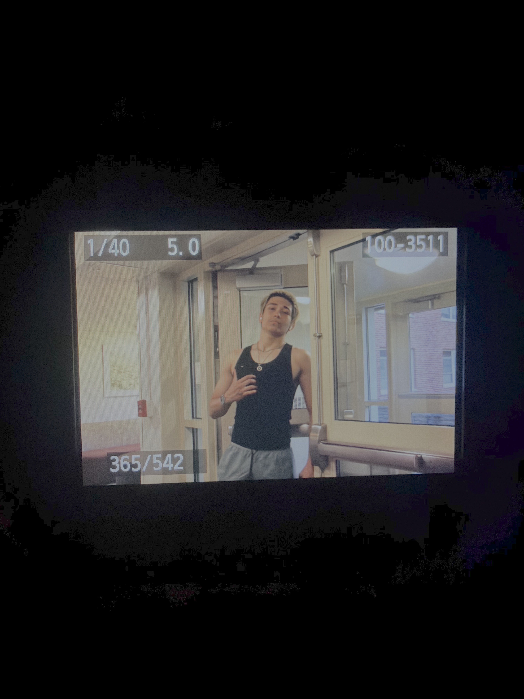

# Deniz Gurcan — Web Designer & Student-Athlete Profile

## About Me
Hi! My name is **Deniz Gurcan**, and I am a college student at **SUNY New Paltz** and a competitive swimmer on the *New Paltz Hawks Swim Team*. When I am not in the pool at Elting Pool or travelling for swim meets, I am learning how to build clean, modern websites in CPS110. 

In the past, I used to think web design was just ~~dragging boxes around on Wix~~, but now I use `Visual Studio Code`, `HTML5`, and `CSS3` to build sites from scratch and track my changes with `Git`.



---

## Technical Background & Web Design Tools

### Favorite Tools & Skills
* **Visual Studio Code** for writing and organizing HTML and CSS files.
* **GitHub & GitHub Desktop** for version control and publishing live websites.
* **Canva & Figma** for planning layouts, color palettes, and mockups.
* **URL & File Path Debugging** on case-sensitive Linux servers.

### My 4-Step Plan to Master Web Design This Semester
1. Plan every website first with a clear folder structure (`index.html`, `styles/`, and `images/`).
2. Write clean, semantic HTML tags with proper heading hierarchy and image `alt` text.
3. Style layouts using CSS Flexbox, high-contrast colors, and readable spacing.
4. Commit and push updates regularly to GitHub so my live site is always up to date.

---

## Inspiration & Favorite Links

> "Hard work beats talent when talent fails to work hard—both in the swimming pool and when debugging code."

Here are two resources I use for athletics and web development:
* Check out the [Official SUNY New Paltz Hawks Athletics Website](https://nphawks.com) to follow our swim season.
* Visit [MDN Web Docs for HTML & CSS](https://developer.mozilla.org/) for helpful web design guides.

### Web Design Inspiration Graphic


---

## Sample Code That Represents Me
Here is a snippet of `html` code from my SUNY New Paltz Swim Team midterm project:

```html
<section class="swim-card">
    <h2>Deniz Gurcan</h2>
    <p>Team: SUNY New Paltz Hawks Swimming</p>
    <a href="schedule.html">View 2026-2027 Meet Schedule</a>
</section>


